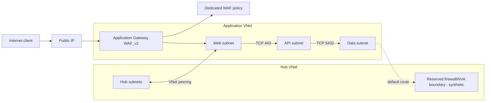

# Production Cloud Network Platform

A synthetic Azure hub-and-spoke networking reference implemented in Terraform. This repository demonstrates secure ingress, tier segmentation, routing, NSG policy, Application Gateway/WAF configuration and offline Terraform validation without deploying live Azure infrastructure.

> This repository is an architecture and Terraform engineering reference, not a live production deployment.

## 🚀 Overview

The implementation models a public Application Gateway frontend, three application tiers, a dedicated App Gateway subnet, hub/application VNet peering and a synthetic firewall/NVA egress boundary.

It is designed to demonstrate technical judgement around:

- hub-and-spoke topology
- ingress and WAF policy
- tiered east-west trust
- module-owned security baselines
- route tables and synthetic egress paths
- variable validation and Terraform testing
- credential-free/mock-provider CI

## 🏗️ Architecture



The Terraform code creates the VNets, subnets, NSGs, route tables, peering, public IP, Application Gateway and WAF resources in an offline model. The Azure Firewall/NVA resource itself is not implemented.

## 🔐 Security Model

- Application Gateway is isolated in its own subnet.
- Web, API and Data tiers use dedicated NSGs.
- Module-owned `DenyAllInbound` rules remain below custom allow rules.
- App Gateway → Web is limited to HTTPS.
- Web → API is limited to HTTPS.
- API → Data is limited to PostgreSQL.
- Reserved subnet names cannot inherit ordinary NSG or route-table associations.
- WAF is enabled in Prevention mode by default.
- Backend TLS/SNI trust is modeled synthetically.
- No live credentials or certificates are committed.

See [docs/security-model.md](docs/security-model.md).

## 🧱 Terraform Design

### Network module

- Hub and application VNets
- Tier subnets
- NSG validation and deny baselines
- Route tables and association logic
- VNet peering
- Reserved subnet handling

### Ingress module

- Public IP
- Application Gateway WAF_v2
- Dedicated WAF policy
- HTTPS listener and backend probe
- Synthetic trusted-root certificate model
- Application Gateway diagnostic settings

The modules expose typed variables and outputs and include native Terraform tests.

## 🧪 Testing and Quality

Validated locally and in GitHub Actions:

```bash
terraform fmt -check -recursive
terraform -chdir=terraform/modules/network init -backend=false -input=false
terraform -chdir=terraform/modules/network validate
terraform -chdir=terraform/modules/ingress init -backend=false -input=false
terraform -chdir=terraform/modules/ingress validate
terraform -chdir=terraform/examples/dev init -backend=false -input=false
terraform -chdir=terraform/examples/dev validate

terraform -chdir=terraform/modules/network test
terraform -chdir=terraform/modules/ingress test
```

Tests use `mock_provider` and isolated Azure configuration directories.

## 🔄 Engineering Lifecycle

**Plan → Build → Validate → Secure → Deploy → Operate → Improve**

This repository implements planning, Terraform construction, offline validation and security modeling. It does not perform deployment or live operation.

## 🚦 Quick Start

```bash
terraform -chdir=terraform/examples/dev init -backend=false -input=false
terraform -chdir=terraform/examples/dev validate
terraform -chdir=terraform/modules/network test
terraform -chdir=terraform/modules/ingress test
```

The example does not deploy Azure resources.

## 🌐 Traffic Flow

1. Client traffic reaches the public Application Gateway IP.
2. WAF inspects HTTPS requests.
3. Traffic reaches the Web tier on TCP 443.
4. Web tier traffic reaches the API tier on TCP 443.
5. API tier traffic reaches the Data tier on TCP 5432.
6. Application egress follows the synthetic NVA/default-route boundary.

See [docs/traffic-flows.md](docs/traffic-flows.md).

## 🗄️ State and Environments

No production backend or state is configured. A real consumer must supply its own remote backend, state locking and environment separation.

See [docs/state-and-environments.md](docs/state-and-environments.md).

## 📦 Repository Structure

```text
.github/workflows/  Terraform CI
terraform/
  examples/dev/     Synthetic module composition
  modules/network/  Hub-spoke, NSG, route and peering module
  modules/ingress/  Application Gateway, WAF and diagnostics module
docs/               Architecture, security, traffic, roadmap and runbook
```

## ⚠️ Scope and Limitations

- Synthetic/offline reference only
- No live Azure deployment
- No live firewall/NVA resource
- No live telemetry collection
- No production state backend
- No real certificate material
- Mock-provider tests only

## 🛡️ Clean-Room Statement

The repository contains synthetic resource names, RFC1918 architecture addressing and synthetic hostnames. It contains no employer/client environment data or credentials.

## 📚 Documentation

- [Architecture](docs/architecture.md)
- [Security model](docs/security-model.md)
- [Traffic flows](docs/traffic-flows.md)
- [State and environments](docs/state-and-environments.md)
- [Runbook](docs/runbook.md)
- [Roadmap](docs/roadmap.md)
